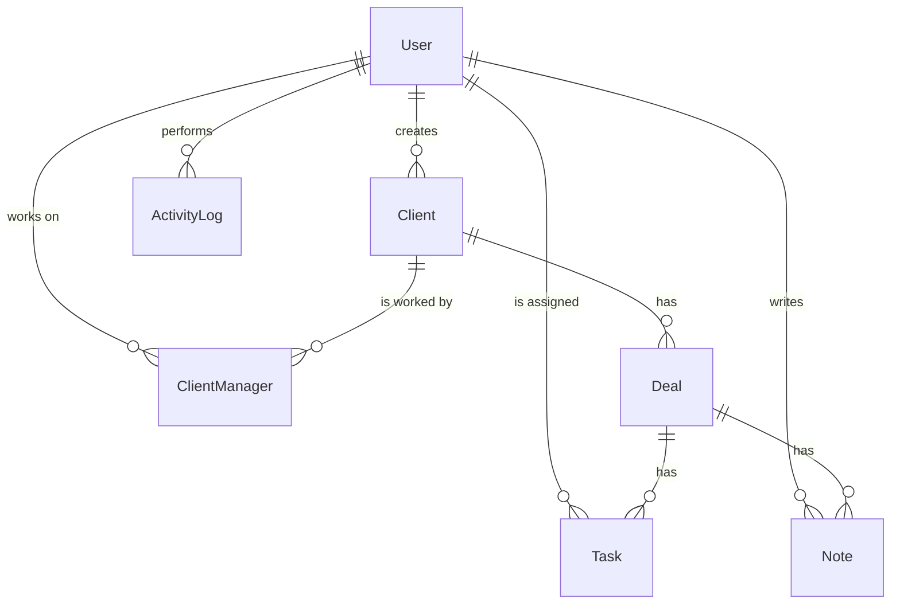

# ClientFlow CRM

A REST API for a small-team CRM: clients, sales deals and tasks, with JWT authentication, roles and per-client access: a manager works only with the clients assigned to them.

> 🚧 **Work in progress.** The backend core is in place and covered by unit tests; see the [roadmap](#roadmap) for what comes next.

## Tech stack

- **NestJS 11** with **TypeScript**
- **PostgreSQL** with **Prisma ORM** (schema and migrations)
- **JWT** access and refresh tokens with **Passport**, passwords hashed with **bcrypt**
- **class-validator** / **class-transformer** for request validation
- **Jest** for unit tests, **ESLint** and **Prettier**

## What works today

**Authentication**
- Register, login, logout and token refresh
- Short-lived access token plus a refresh token that is **rotated on every refresh**; only a bcrypt hash of the refresh token is stored, so a database leak does not expose live tokens
- Roles (`ADMIN`, `MANAGER`) with a custom `@Roles()` decorator and `RolesGuard`

**Clients**
- An admin creates clients; a new client waits in a **pool** until a manager takes it
- Read and update, limited to the clients you are assigned to (an admin sees all)
- Pagination, text search, filters by status and creation date, sorting by name or date
- A client can have several managers: any assigned manager or an admin adds or removes managers

**Deals**
- Create, read, update, linked to a client
- Deal stages: `NEW`, `QUALIFICATION`, `NEGOTIATION`, `WON`, `LOST`. An open deal can move to any stage, including skipping or going back. `WON` and `LOST` are final: trying to move a closed deal returns **409 Conflict**. Other fields of a closed deal stay editable.
- Optional expected close date (date only, no time-zone drift)

**Tasks**
- Create, read, update, assigned to a user and optionally linked to a deal
- A task can be handed to another manager of the same client (`assigneeId`)
- Separate status endpoint, and a `?mine=true` filter for the current user's tasks

**Quality**
- Environment variables validated at startup: the app refuses to boot with a missing secret or a malformed duration
- Global `ValidationPipe` with whitelisting: unknown fields are rejected with 400
- **736 unit tests** across services, repositories, controllers and DTOs

## Access model

Roles are `ADMIN` and `MANAGER`. Access is decided per client:

- **Pool.** A client with no manager is in the pool. Every manager sees the pool, but only a short card (name, status, date added): contacts stay hidden until the client is taken, so a client cannot be worked on without being claimed. `POST /clients/:id/claim` takes a client; two managers claiming at once get one winner and a 409 (the client row is locked inside a transaction).
- **Own clients.** Once assigned, a manager sees and edits the client with its deals and tasks and with its full history. A client assigned to someone else is **invisible**: the API answers 404, the same as for a client that does not exist.
- **Teamwork.** An assigned manager (or an admin) can add any user as another manager and can remove managers, themselves included. The last manager leaving returns the client to the pool.
- **Tasks.** A task with a deal is seen by everyone assigned to its client. A task without a deal is seen only by its assignee. A task with a deal can only be given to a manager assigned to that client; a manager creates deal-less tasks only for themselves.
- **Leaving.** A manager cannot be removed from a client while holding open tasks (`TODO`, `IN_PROGRESS`) on it: they must be handed over (`PATCH /tasks/:id` with `assigneeId`) or closed first (409 otherwise).
- **Admin.** Sees all clients, deals and tasks, creates clients and may assign managers. An admin who also works with clients assigns themselves like any manager.

## Architecture

Each feature is a NestJS module split into three layers:

```
controller  →  service  →  repository  →  Prisma
(HTTP, DTOs)   (business rules)  (data access)
```

Controllers only handle HTTP and validation, services hold the business rules (for example the deal stage transition rule), and repositories are the only layer that talks to Prisma. This keeps the rules testable without a database.

```
backend/src
├── auth/        # login, register, refresh, JWT strategies and guards
├── users/       # current user, colleague list, user list (admin only)
├── clients/
├── deals/
├── tasks/
├── common/      # @CurrentUser, @Roles, RolesGuard, managerScope
├── config/      # environment validation
└── prisma/      # PrismaService
```

## Data model



`ClientManager` links a client to the managers working on it (many to many); a client with no rows is in the pool. `Note` and `ActivityLog` already exist in the schema; their API modules are on the roadmap.

## API

All routes except `register`, `login` and `refresh` require `Authorization: Bearer <access token>`.

| Method | Route | Description |
|---|---|---|
| POST | `/auth/register` | Create an account, returns tokens |
| POST | `/auth/login` | Log in, returns tokens |
| POST | `/auth/refresh` | Exchange a refresh token for a new pair |
| POST | `/auth/logout` | Invalidate the refresh token |
| GET | `/users/me` | Current user |
| GET | `/users/colleagues` | Everyone as `id`, `name`, `role`, to pick a second manager |
| GET | `/users` | All users with full data (**ADMIN** only) |
| POST | `/clients` | Create a client (**ADMIN** only), it lands in the pool |
| GET | `/clients` | Your clients: `page`, `limit`, `search`, `status`, `createdAfter`, `sort`, `order` (an admin: all) |
| GET | `/clients/pool` | Clients nobody works with yet (short card): `page`, `limit` |
| POST | `/clients/:id/claim` | Take a client from the pool |
| GET | `/clients/:id` | Get one of your clients |
| PATCH | `/clients/:id` | Update one of your clients |
| GET | `/clients/:id/managers` | Managers of a client |
| POST | `/clients/:id/managers` | Add a manager, body `{ "userId": 5 }` |
| DELETE | `/clients/:id/managers/:userId` | Remove a manager (409 while they hold open tasks) |
| POST | `/deals` | Create a deal |
| GET | `/deals` | List deals of your clients |
| GET | `/deals/:id` | Get a deal |
| PATCH | `/deals/:id` | Update a deal (stage rule enforced) |
| POST | `/tasks` | Create a task |
| GET | `/tasks` | List the tasks you may see, `?mine=true` for those assigned to you |
| GET | `/tasks/:id` | Get a task |
| PATCH | `/tasks/:id` | Update a task, or hand it over with `assigneeId` |
| PATCH | `/tasks/:id/status` | Change only the status |

## Getting started

Requirements: Node.js 20+ and a running PostgreSQL instance.

```bash
cd backend
npm install
cp .env.example .env          # then fill in DATABASE_URL and two JWT secrets (16+ chars)
npx prisma migrate dev
npm run start:dev             # http://localhost:3000
```

Run the tests:

```bash
npm test
npm run test:cov              # with coverage report
```

## Roadmap

The project is built in 15 stages, each finished stage landing as its own commit.

**Done**
- [x] 1. NestJS project setup
- [x] 2. Prisma + PostgreSQL: schema and migrations
- [x] 3. Auth: JWT access and refresh tokens with rotation
- [x] 4. Users and roles (`ADMIN`, `MANAGER`)

**Implemented, closing the gaps**
- [x] 5. Clients CRUD
- [x] 6. Pagination, search, filters and sorting for clients
- [x] 7. Deals CRUD, linked to clients, with an expected close date
- [x] 8. Deal stages with transition rules (`WON` / `LOST` are final, 409 otherwise)
- [x] 9. Tasks: assignee, status endpoint, "my tasks" filter
- [x] Access model: client pool, several managers per client, a manager sees only their own clients, deals and tasks, an admin sees everything
- [ ] `manager` filter on `GET /clients` for admins (who works with whom)

**Next**
- [ ] 10. Notes: comments on deals
- [ ] 11. Dashboard: pipeline value per stage, won deals, overdue tasks
- [ ] 12. Activity log: who changed what and when
- [ ] 13. Soft delete: archive clients (the `deletedAt` column is ready)
- [ ] 14. Swagger docs and a global error handler (consistent error format, Prisma errors mapped to HTTP)
- [ ] 15. Docker Compose, seed data, end-to-end tests against a real database, CI

**After the plan**
- [ ] Public demo deployment
- [ ] Web frontend

## Author

**Artem Volodin**, junior backend developer based in Alicante, Spain. [GitHub](https://github.com/dabrbb) · [LinkedIn](https://www.linkedin.com/in/artem-volodin-04a235283/)
